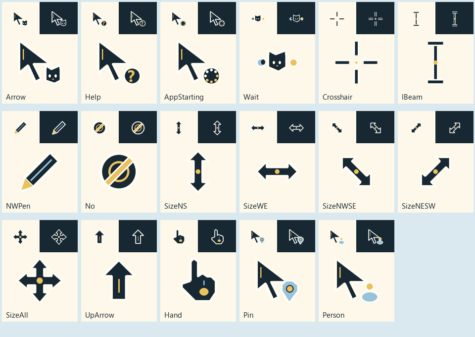
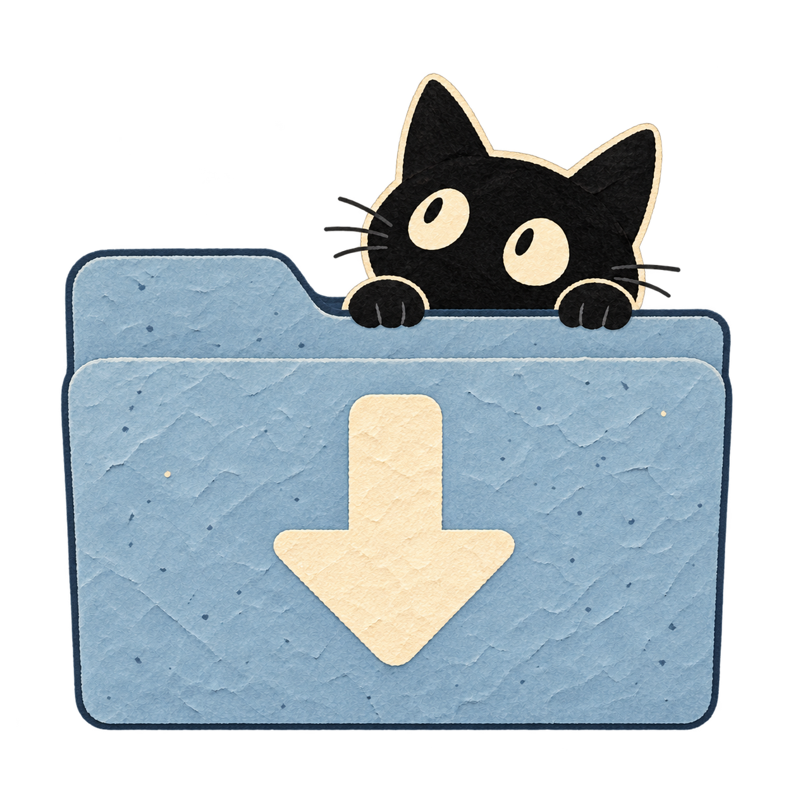

# Cozy Desktop ☀️ 🌙

[](https://github.com/SimpleCaci/cozy-desktop/actions/workflows/windows.yml)

Make your PC feel a little more like you.

This started with me wanting a cute wallpaper… then a button to switch between day and night… then matching Recycle Bin icons… and honestly, why stop there?

Cozy Desktop bundles that setup into something you can try, customize, and undo. The first theme is **Sunbeam Kitty**: a tiny black cat, dusty blue, butter yellow, paper textures, sunshine, and moonlight.

| Day | Night |
| --- | --- |
|  |  |

## What you get

- Matching landscape **and portrait** wallpapers, chosen separately for each monitor.
- Desktop buttons for **Day**, **Night**, **Toggle**, and **Auto**.
- Windows light/dark appearance that follows the wallpaper choice.
- Matching empty/full Recycle Bin, This PC, Network, user files, and Libraries icons.
- 17 native cursor roles, including animated busy and working pointers.
- Folder icons you can apply to folders you choose.
- Optional local-time day/night scheduling. No resident background app.
- Backups and a restore command for the settings this toolkit changes.



| Network | This PC | Recycle Bin | Downloads | Music |
| --- | --- | --- | --- | --- |
|  |  |  |  |  |

## Try it

For Windows 10/11 desktop sessions with Windows PowerShell 5.1 and .NET Framework 4.x. Development checks currently run on Windows 11; Windows 10 and managed PCs still need broader testing. Use your normal user account. No administrator terminal is needed.

1. Click **Code → Download ZIP** and extract the **whole folder** somewhere you can find again.
2. Open **Windows PowerShell** in that folder. Review the scripts, then preview the installation:

   ```powershell
   powershell.exe -NoProfile -ExecutionPolicy Bypass -File .\Install.ps1 -WhatIf
   ```

3. Install:

   ```powershell
   powershell.exe -NoProfile -ExecutionPolicy Bypass -File .\Install.ps1
   ```

That's it! Use **Cozy Desktop - Toggle** on your desktop whenever you want the other look.

The installer builds the tiny button program from source and copies the toolkit to `%LOCALAPPDATA%\CozyDesktop`. Windows keeps referring to those installed assets, so keep that folder in place. After installation, the downloaded/extracted source folder can be moved or removed.

`ExecutionPolicy Bypass` applies only to that PowerShell process; it does not change your saved execution policy. An organization's policy may still block scripts. The build uses Windows' included .NET Framework compiler; no SDK download is needed on the tested machine.

### Make it automatic

Use this **instead of** the install command above:

```powershell
powershell.exe -NoProfile -ExecutionPolicy Bypass -File .\Install.ps1 -AutoSwitch
```

Day starts at **7 am**, night at **7 pm**, using your PC's local clock. AutoSwitch creates a task for those times and sign-in, with missed runs allowed after sleep while signed in. The task runs briefly and exits. It does not calculate sunrise/sunset. To change the scheduled hours, edit `config.json` before installing. Restore before reinstalling with different options or hours.

**Day/Night** set a look now. **Toggle** alternates from the toolkit's last applied look. **Auto** chooses by the current hour once. A manual choice lasts until the next scheduled run when AutoSwitch is enabled.

### Go all in on matching icons

To include Desktop, Documents, Downloads, Pictures, Music, Videos, Favorites, and Saved Games folder icons, install with:

```powershell
powershell.exe -NoProfile -ExecutionPolicy Bypass -File .\Install.ps1 -AutoSwitch -FolderIcons
```

Windows supplies the actual folder locations, including redirected and localized paths. Missing folders are skipped. Each changed folder is backed up individually. Some special shell views cache or substitute their own icons; reopen Explorer or sign out/in to see updates.

Already installed? Add these icons without reinstalling:

```powershell
$cozy = Join-Path $env:LOCALAPPDATA 'CozyDesktop'
powershell.exe -NoProfile -ExecutionPolicy Bypass -File "$cozy\scripts\Set-DefaultIcons.ps1" -IncludeFolders
```

### Pick just the pieces you want

```powershell
# Wallpapers + Windows light/dark + buttons, without the system icons or cursors:
powershell.exe -NoProfile -ExecutionPolicy Bypass -File .\Install.ps1 -SkipIcons -SkipCursors
```

## Give a folder a little personality

After installation, run this in Windows PowerShell:

```powershell
$cozy = Join-Path $env:LOCALAPPDATA 'CozyDesktop'
powershell.exe -NoProfile -ExecutionPolicy Bypass -File "$cozy\scripts\Set-FolderIcon.ps1" -Path "$HOME\Documents\My Project" -Icon code
```

The folder must already exist. Try `blue`, `yellow`, `navy`, `school`, `games`, `apps`, `files`, `archive`, `pictures`, `downloads`, `music`, `videos`, or `code`. More icons are in `themes/sunbeam-kitty/icons`. Add `-WhatIf` to preview.

This changes that folder's icon using `desktop.ini` and backs up its previous bytes and attributes. It does not move files or change the default save locations for Documents, Downloads, etc. Windows' Home tiles and some special folders may continue showing built-in icons. For an app shortcut, use **Properties → Change Icon** and choose an `.ico` from the installed theme; manual changes are not tracked by Restore.

## Undo it

In Windows PowerShell:

```powershell
$cozy = Join-Path $env:LOCALAPPDATA 'CozyDesktop'
powershell.exe -NoProfile -ExecutionPolicy Bypass -File "$cozy\scripts\Reset.ps1"
```

Reset removes the toolkit's scheduled task and desktop buttons, restores the saved registry values, static monitor wallpapers and fit mode, and restores folder icon metadata. It returns your pre-install setup, including any custom appearance you already had. `Restore.ps1` does the same thing. It keeps the installed files and archives the backup. Once restoration succeeds, you can delete the installed folder yourself.

Backups stay locally in the installed `.state` folder and never belong in Git. Restore returns tracked settings to their **pre-install values**, including folder metadata, so later manual edits to those same settings will be replaced. Keep the original wallpaper files and reconnect themed monitors before restoring. Missing originals or disconnected monitors leave the backup in place so you can fix the issue and retry. Windows slideshow playback/position is not backed up; choose your slideshow again in Settings if needed.

If installation stops halfway through, use the same Restore command from the install location printed in the error. Folder and system icons can be cached; reopen Explorer or sign out/in if they do not update immediately. The toolkit does not force-close Explorer.

## Make your own theme

See [the theme guide](docs/THEMES.md). Copy the theme folder, replace assets, edit its manifest, and point `config.json` to it before installing. Contributions and extra theme ideas are welcome!!

## For people who want to tinker

```powershell
.\scripts\Build.ps1
.\tests\Test.ps1
```

The button's C# source lives in `src/Launcher.cs`; appearance, backups and restoration live in `scripts/CozyDesktop.psm1`. No prebuilt executable is committed. CI builds it and checks assets, switching logic, and backup/restore behavior without changing the runner's real appearance.

See [credits](docs/CREDITS.md) for the original artwork's provenance and [Windows API references](docs/REFERENCES.md) for the native integration. Code and supplied assets are distributed under [MIT](LICENSE), to the extent copyright applies. This is a community project, not affiliated with Microsoft.

Changes are recorded in [the changelog](CHANGELOG.md). See [open issues](https://github.com/SimpleCaci/cozy-desktop/issues) for compatibility checks and next steps, and [contributing](CONTRIBUTING.md) if you'd like to help.
